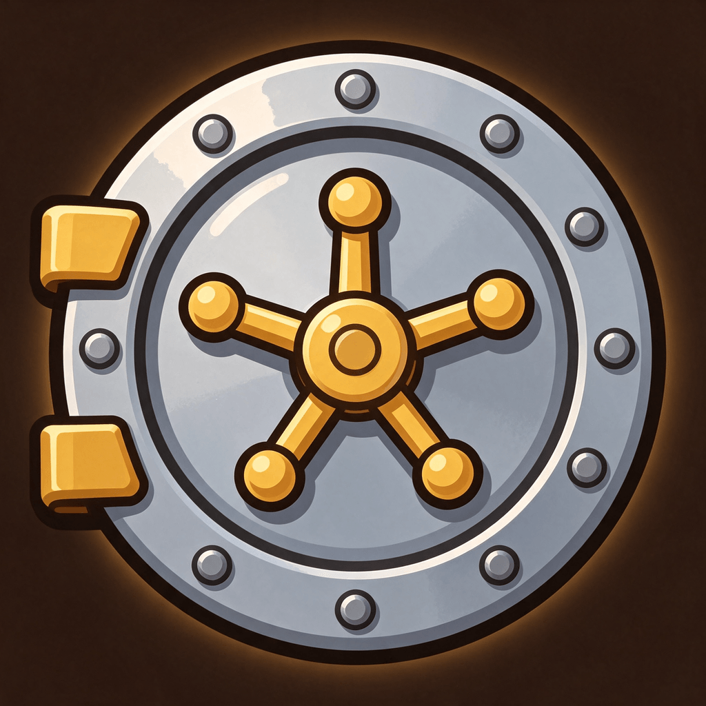

# Crack the Vault

<p align="center">
  
</p>

> **One vault. One subreddit. Three tries each. Crack it together — then go deeper.**

Crack the Vault is a daily, community-wide code-breaking game for Reddit: every UTC day your
subreddit shares one vault with a secret code, every guess becomes a public clue on a live
board, and the whole crowd deduces the code together until someone cracks it — and a harder
vault opens.

## How to play

1. **Open today's post.** A new vault post appears in the subreddit at **00:00 UTC** every day.
   Tap **Crack it** in the feed to open the game.
2. **Set the dials and try a code.** You get **3 tries per UTC day** — moderators too, no
   bypass. Tap ▲/▼, drag a dial, or type digits on a keyboard.
3. **Read the clue.** Every try is scored with counts only, never per dial:
   - 🟢 how many digits are on the **right dial**,
   - 🟡 how many more are in the code but on **another dial**.
4. **Use everybody's clues.** Every try from every player lands on one **shared, real-time clue
   board**. The board also tells you how many codes are still possible ("X codes left"), so
   three tries are enough to matter when you read the crowd's clues first.
5. **The drill.** A vault nobody cracks slowly gives way: **every 6 hours one dial is drilled
   open** for everyone (position and digit). The last dial is never drilled — someone always
   has to guess it.
6. **Crack it.** The first player whose code matches cracks the vault. **Vault #N+1 opens
   immediately and is harder**: more dials, wider digit ranges, up to 6 dials of 0–9.

### Rewards

- **Safecracker of the Day 🔓** — whoever cracks a vault gets the user flair
  "Safecracker of the Day 🔓"; one holder per subreddit, so the next crack moves it on and the
  previous holder's own flair comes back. For every crack the app comments on the day's post:
  "u/X cracked vault #N (name) in K guesses 🔓" followed by "The code was `…`. Vault #N+1 is
  open now."
- **Streak 🔥** — consecutive UTC days on which you tried at least one code.
- **Leaderboard 🏆** — today's deepest vault, the subreddit's all-time deepest, today's
  crackers, the top 10 safecrackers of all time and your own rank.

## Why it's made for Reddit

- **The community is the solver.** Three tries per person can't brute-force a vault; a crowd
  reading each other's clues can. Each clue is a public contribution with a username on it,
  and the board updates live while you watch.
- **A daily ritual with a shared score.** One post per day, one board per subreddit, and a
  single number to beat: how deep did _we_ get today?
- **Fame lives on Reddit.** The flair and the crack comment put the winner in front of the
  whole subreddit — and the comment thread is where the crowd argues about the next guess.
- **Every size of community works.** Vault #1 is easy every day and the drill backs it up, so a
  small subreddit cracks at least one vault; a big one dives ten or more vaults deep.
- **Lightweight in the feed.** The inline splash is plain DOM + CSS, about 8 KB gzip (JS + CSS);
  the game opens in expanded mode with small synthesised sound effects (🔊/🔇).

## Fair play

- **The secret never leaves the server.** The active code lives only in Redis and is never
  sent to a client; only codes of cracked vaults are public. Drilled dials are derived on the
  server from the round's start time.
- **Every guess is validated server-side**, and the try limit and the crack run inside one
  Redis transaction: exactly **one cracker per vault**, even when two players submit the same
  code at the same moment.
- **Accounts must be at least 3 days old** to try codes (watching is open to everyone).
- Feedback is counts only, so a clue never reveals which dial is right.

## Tech

- **Devvit Web** — `splash.html` (inline feed view) and `game.html` (expanded view), plain
  TypeScript DOM + CSS, built with Vite. No game engine.
- **Hono** server routes on Devvit's serverless Node runtime: `GET /api/state`,
  `POST /api/guess`, `GET /api/leaderboard`, plus scheduler / trigger / menu endpoints.
- **Redis** for secrets, clues, limits, streaks and records (WATCH/MULTI transactions).
- **Realtime** channel per subreddit and day: new clues, drilled dials and cracks reach every
  open game instantly; the client falls back to polling when disconnected.
- **Reddit API** for the daily post (cron at 00:00 UTC), the flair and the crack comment.
- **Web Audio** for sound effects synthesised at runtime (no audio files), started only after
  the player's first tap.

## Development

Requires Node ≥ 24 (`.nvmrc`).

```sh
npm install
npm run dev          # devvit playtest on the dev subreddit (needs `npm run login`)
npm run type-check   # tsc --build
npm run lint         # eslint
npm run test:unit    # node --test tests/
npm run build        # vite build → dist/client, dist/server
npm run sim          # crowd difficulty simulation (~2 min)
npm run preview:ui   # local UI preview with mock data → http://localhost:5199/game.html?s=board
```

Preview scenarios are listed in [`tools/preview/README.md`](tools/preview/README.md); the
client ↔ server contract (events, refetch flow) is in
[`docs/client-contract.md`](docs/client-contract.md).

Layout: `src/shared/vault.ts` (rules, scoring, parsing), `src/shared/api.ts` (API types +
runtime parsers), `src/server` (Hono routes + Redis), `src/client` (DOM/CSS, no engine),
`tools/sim` (crowd simulation), `tools/preview` (mock UI preview).

## Under the hood

### The difficulty ladder

Vault #1 is the same easy rung every day. From vault #2 the weekday decides how far the day
jumps up the ladder, and every later vault climbs one more rung (capped at the top, the most a
phone dial UI holds). Digits may repeat on every rung; the spec is a pure function
`specFor(day, round)` in `src/shared/vault.ts`.

| Rung | Dials | Digits | Codes     | Vault #2 on                                     |
| ---- | ----- | ------ | --------- | ----------------------------------------------- |
| 0    | 3     | 0–4    | 125       | (vault #1, every day)                           |
| 1    | 3     | 0–5    | 216       | Mon Copper Lockbox, Tue Brass Strongbox (easy)  |
| 2    | 4     | 0–5    | 1 296     | Wed Steel Safe, Thu Bank Vault (medium)         |
| 3    | 4     | 0–7    | 4 096     | Fri Titanium Vault (hard)                       |
| 4    | 4     | 0–9    | 10 000    | Sat Royal Treasury, Sun Dragon's Hoard (expert) |
| 5    | 5     | 0–7    | 32 768    |                                                 |
| 6    | 5     | 0–9    | 100 000   |                                                 |
| 7    | 6     | 0–8    | 531 441   |                                                 |
| 8    | 6     | 0–9    | 1 000 000 | (top, repeats)                                  |

### The drill

Vault #1 starts when its secret is first created (normally right after 00:00 UTC), vault #N+1
at the crack of vault #N. The opening order is a random (crypto) permutation stored next to the
secret and never changes. The number of open dials is derived on every request from the round
start and the clock (`src/shared/drill.ts`), never written step by step, so concurrent requests
agree and no cron is needed.

### "X codes left"

`remainingCodes(spec, clues, revealed)` (shared, pure) enumerates the whole code space with
an odometer, running digit counts and early exit on the first broken clue or drilled dial. The
server computes it over all clues of the active round, caches it per (round, clue count, open
dials) and lets only one request recompute at a time (others get the previous value, marked
stale). On the top rung (1 000 000 codes) it takes ~25 ms with 1–200 real clues.

### Crowd simulation

`npm run sim` plays whole days with a mixed crowd (1% solvers using every clue, 50% casual
players reading the newest clues, 49% random codes), players arriving at random times with all
3 tries, and the drill opening a dial every 6 hours. Results (30 days per cell):

| Tier (vault #2 rung) | Vaults/day 10 / 50 / 500 players | Days without a crack 10 / 50 / 500 |
| -------------------- | -------------------------------- | ---------------------------------- |
| easy (3×0–5)         | 1.8 / 4.2 / 12.5                 | 3% / 0% / 0%                       |
| medium (4×0–5)       | 1.6 / 3.4 / 11.1                 | 3% / 0% / 0%                       |
| hard (4×0–7)         | 1.5 / 2.8 / 10.4                 | 0% / 0% / 0%                       |
| expert (4×0–9)       | 1.3 / 2.7 / 9.7                  | 0% / 0% / 0%                       |

Ten players crack at least one vault a day on every weekday; 500 players reach vault #10–12.
The share of strong players is the main unknown and will be re-checked with real data.

## License

See [LICENSE](LICENSE).
